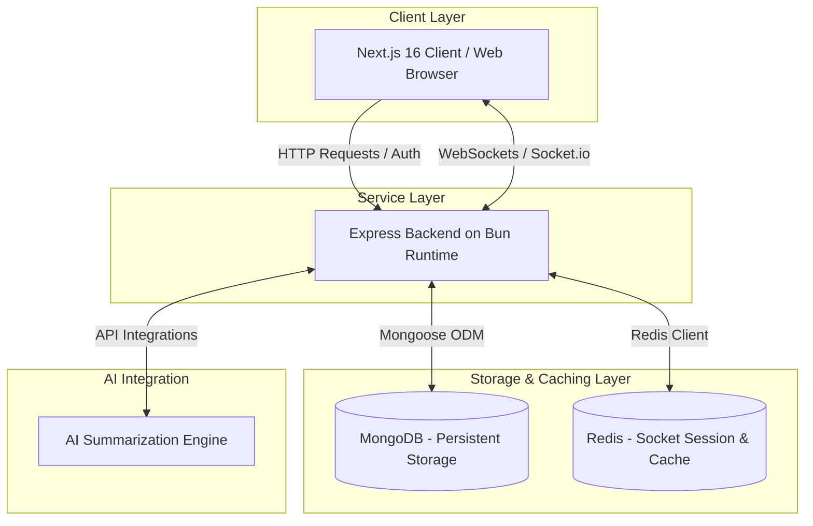

# Open Poll Platform 🥟

_The intelligent, real-time polling platform that helps you capture sentiments and harvest actionable AI-powered insights instantly._

## 💡 Inspiration

We live in a world overflowing with data, yet gathering real-time, meaningful feedback remains surprisingly difficult. Traditional forms and polls are static, boring, and require manual analysis. We wanted to build a platform that not only captures votes instantly but also uses AI to understand the _why_ behind the choices.

## 🚀 What it does

Open Poll is a modern, full-stack polling application that offers:

- **Instant Real-time Polling**: Cast your vote and watch the charts update live for everyone connected, powered by WebSockets.
- **AI-Powered Analytics**: We don't just count votes. Our built-in AI analyzes responses to generate intelligent summaries and spot emerging trends.
- **Engaging User Experience**: A beautiful, highly responsive, and accessible UI that makes participating in polls feel delightful instead of like a chore.
- **Seamless Authentication**: Sign in with OpenID Connect, Google OAuth, or email/password.

## 🛠️ How we built it

We utilized a cutting-edge modern web stack designed for speed, scale, and developer experience:

- **Frontend**: Next.js 16 (App Router), TypeScript, Tailwind CSS, Shadcn UI, and Framer Motion for buttery-smooth animations.
- **Backend**: Bun for an ultra-fast runtime, Express.js for our API, and Socket.io for low-latency, real-time bidirectional communication.
- **Database & Caching**: MongoDB (with Mongoose) for flexible document storage, and Redis to handle fast socket session management and caching.
- **AI Integration**: Custom AI modules integrated into the backend architecture to process and summarize poll data on the fly.
- **DevOps & Architecture**: Fully Dockerized environments with Docker Compose for absolute "it works on my machine (and production)" reliability.

## 👤 Creator & System Architecture

**Open Poll** is a real-time, AI-driven polling platform created by me using a high-performance, containerized tech stack comprising Next.js 16, Bun, Express, TypeScript, MongoDB, Redis, and Docker. 

This platform was developed to revolutionize traditional, static data collection by enabling instantaneous WebSocket-driven sentiment sharing combined with automated, context-aware AI insights. Designed with a robust microservice-like structure, the application separates its high-throughput real-time backend from a highly responsive, animated frontend, ensuring horizontal scalability, caching efficiency, and a frictionless experience for users casting votes and exploring AI-generated analysis.

### 🏗️ Architecture Diagram



### ⚙️ Component Flow
1. **Frontend (Next.js 16)**: Leverages React Server Components (RSC) and client-side hooks for a modular layout, animated with Framer Motion, and connects to the WebSocket gateway for live graph updates.
2. **Backend (Bun & Express)**: Orchestrates the API routes, WebSocket connections via Socket.io, and routes incoming analytics payloads to the AI module.
3. **Data Tier (MongoDB & Redis)**: MongoDB stores persistent poll structures and user records, while Redis acts as a high-speed broker for socket adapter pooling and session state synchronization.

## 🚧 Challenges we ran into

- Managing state synchronization and preventing race conditions when hundreds of users vote simultaneously in real-time.
- Structuring prompt engineering to ensure the AI provides unbiased, strictly analytical insights rather than hallucinations based on poll text.
- Integrating a seamless monorepo-like feel with separate Dockerfiles for the Next.js frontend and Express/Bun backend while keeping hot-reloading active.

## 🏆 Accomplishments that we're proud of

- Successfully orchestrating the real-time syncing between Redis, MongoDB, and Next.js clients.
- Delivering a gorgeous, polished UI that feels incredibly responsive.
- Building the entire platform to be 100% Dockerized and VPS-deployment ready from day one.

## 🎓 What we learned

- The immense power and speed of Bun when used in a containerized full-stack environment.
- How to efficiently pipe real-time socket events natively into Next.js React Server Components and client hooks.
- How to effectively utilize Redis as an adapter for scaling Socket.io nodes.

## 🚀 What's next for Open Poll

- **Granular AI Reports**: Generating full-page PDF/CSV analytical reports with AI charts.
- **Anonymous/Guest Polling**: Expanding access limits using device fingerprinting instead of strict auth.
- **Poll branching**: Dynamic polls where the next question depends on previous answers.

---

## 💻 Local Development

### Prerequisites

- [Bun](https://bun.sh/) installed.
- A MongoDB instance (local `mongod` or Atlas) and a Redis instance (`docker run -p 6379:6379 redis:7-alpine` works).

### 1. Clone the repository

```bash
git clone <your-repo-url>
cd open_poll
```

### 2. Set up Environment Variables

- Create `backend/.env` (copy from `backend/.env.example`).
- Create `frontend/.env.local` (copy from `frontend/.env.example`).

### 3. Run the backend and frontend

**Backend:**

```bash
cd backend
bun install
bun dev
```

**Frontend:**

```bash
cd frontend
bun install
bun dev
```

### 4. Checks

CI (`.github/workflows/ci.yml`) runs the same commands on every push and pull request:

```bash
cd backend && bun x tsc --noEmit && bun test
cd frontend && bun run typecheck && bun run lint && bun run build
```

---

## 🌐 Deployment

Two supported targets:

- **Vercel** (`vercel.json`): the frontend and the backend (`backend/Dockerfile.vercel`) deploy as two services in one project. `/api`, `/mcp`, `/socket.io` and `/auth/callback` are rewritten to the backend.
- **VPS with Docker Compose** (`docker-compose.yml`): runs **Redis and the backend only**, behind an existing Traefik reverse proxy (external `traefik` network, Let's Encrypt resolver). MongoDB is external (e.g. Atlas) and the frontend is deployed separately. The backend reads secrets from a root-level `.env` file.

```bash
# on the VPS, with Traefik already running
cp backend/.env.example .env   # then fill in production values
sudo docker compose up --build -d
```

On Windows, `./docker.ps1` wraps the same `docker-compose up --build -d`.

---

## 📄 License

MIT License.
